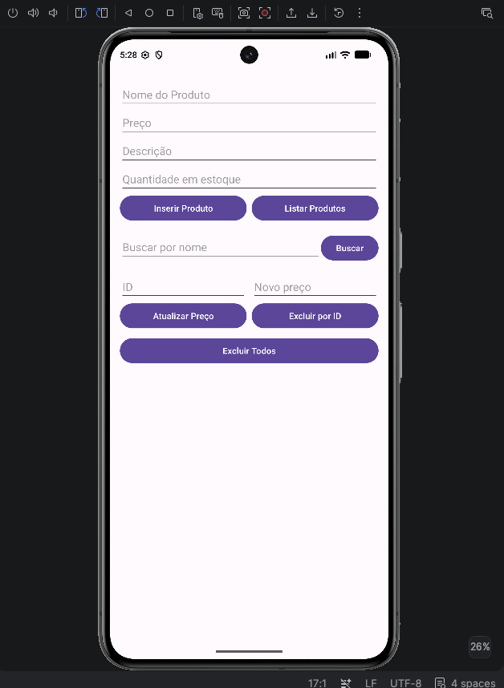
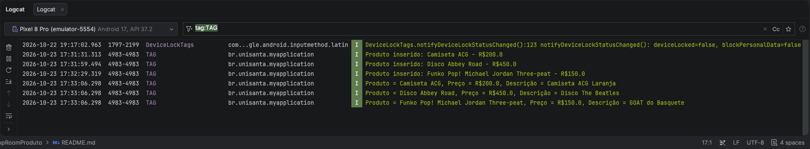

# AppRoomProduto: Cadastro de Produtos com Room SQLite

**Aluno:** Danilo Santos de Almeida e Luiz Felipe Knudsen Rodrigues 
**RA:** 235113, 156465
**Disciplina:** Programação para Dispositivos Móveis  
**Professor(a):** ALESSANDRO FERREIRA PAZ LIMA

## Sobre o projeto

O projeto consiste em um aplicativo Android desenvolvido em Kotlin para cadastrar e gerenciar produtos. Com ele, é possível cadastrar, listar, buscar, atualizar e excluir produtos.

Para salvar os dados, utilizei o Room, que trabalha com o banco de dados SQLite. Dessa forma, os produtos continuam salvos mesmo depois que o aplicativo é fechado.

## Tecnologias utilizadas

- Kotlin
- Room 2.8.4 (SQLite)
- ViewBinding
- Corrotinas com lifecycleScope

## Estrutura do projeto

```text
app/src/main/java/br/unisanta/myapplication/
├── model/Product.kt      ← Entidade dos produtos
├── dao/ProductDao.kt     ← Operações do banco de dados
├── db/AppDatabase.kt     ← Configuração do banco
└── view/MainActivity.kt  ← Tela principal do aplicativo
```

## Prints do aplicativo





---

# Parte A: Complemento prático

## A1. Limpar campos após inserir

**O que foi feito:**

Fiz uma função chamada `limparCampos()` para limpar todos os campos depois que um produto é cadastrado com sucesso. Também coloquei o cursor de volta no campo Nome para facilitar o cadastro de outro produto.

Chamei essa função depois de salvar o produto no banco, assim os campos só são limpos quando a operação termina.

```kotlin
private fun limparCampos() {
    binding.editProductName.text.clear()
    binding.editProductPrice.text.clear()
    binding.editProductDescription.text.clear()
    binding.editProductQuantity.text.clear()
    binding.editProductName.requestFocus()
}
```

**Print:**


## A2. Validação de preço

**O que foi feito:**

Adicionei uma validação para impedir que o usuário cadastre produtos com preços inválidos. Utilizei `toDoubleOrNull()` para converter o valor digitado em número.

Se o campo estiver vazio, tiver um valor inválido ou o preço for menor ou igual a zero, o aplicativo mostra uma mensagem de erro e não salva o produto.

```kotlin
val price = priceText.toDoubleOrNull()

if (price == null || price <= 0.0) {
    binding.editProductPrice.error = "Informe um preço válido"
    binding.editProductPrice.requestFocus()
    return
}
```

**Print:**


## A3. Lista na tela

**O que foi feito:**

Antes, os produtos eram exibidos apenas no Logcat. Para melhorar isso, adicionei um `TextView` chamado `txtListaProdutos` abaixo dos botões.

Agora, quando clico em **Listar Produtos**, os dados continuam aparecendo no Logcat, mas também são exibidos na própria tela. A lista mostra o ID, o nome, o preço, a quantidade e a descrição de cada produto.

```kotlin
binding.txtListaProdutos.text = products.joinToString("\n\n") {
    "#${it.id} - ${it.name}\n" +
        "Preço: ${formatarReais(it.price)}  |  Qtd: ${it.quantity}\n" +
        "Descrição: ${it.description.orEmpty().ifEmpty { "-" }}"
}
```

**Print:**


## A4. Total do estoque

**O que foi feito:**

Adicionei um resumo acima da lista de produtos. Ele mostra quantos produtos estão cadastrados e a soma dos preços registrados.

Para calcular essas informações, utilizei `products.size` para contar os produtos e `sumOf` para somar os preços. O resultado é formatado em reais.

```kotlin
val total = products.sumOf { it.price }

binding.txtResumo.text =
    "Produtos cadastrados: ${products.size}  |  Soma dos preços: ${formatarReais(total)}"
```

**Print:**


## A5. Buscar por nome

**O que foi feito:**

Adicionei um campo de busca e um botão chamado **Buscar**, além de uma função no DAO para pesquisar os produtos pelo nome.

A busca funciona mesmo quando o usuário digita apenas uma parte do nome. Por exemplo, ao pesquisar por "tec", o aplicativo consegue encontrar um produto chamado "Teclado".

Para isso, utilizei o comando SQL `LIKE` com o caractere `%`, que permite encontrar nomes que contenham o texto pesquisado.

```kotlin
// DAO
@Query("SELECT * FROM product WHERE name LIKE :nome")
suspend fun buscarPorNome(nome: String): List<Product>

// MainActivity
val resultado = productDao.buscarPorNome("%$texto%")
mostrarNaTela(resultado)
```

**Print:**


## A6. Excluir produtos

**O que foi feito:**

Implementei a opção de excluir todos os produtos cadastrados por meio do botão **Excluir Todos**.

Também fiz a exclusão de um produto específico como desafio extra. Nesse caso, o aplicativo procura o produto pelo ID e, se ele existir, realiza a exclusão.

```kotlin
// DAO
@Query("DELETE FROM product")
suspend fun deleteAll()

@Delete
suspend fun delete(product: Product)

@Query("SELECT * FROM product WHERE id = :id")
suspend fun getById(id: Int): Product?

// MainActivity (excluir por ID)
val product = productDao.getById(id)

if (product != null) {
    productDao.delete(product)
}
```

**Print:**


## A7. Atualizar produto

**O que foi feito:**

Adicionei a opção de atualizar o preço de um produto. Para isso, o usuário informa o ID do produto e o novo preço e clica em **Atualizar Preço**.

O aplicativo procura o produto pelo ID e, caso ele exista, cria uma cópia com o novo preço usando `copy()`. Depois, utiliza o `@Update` do Room para salvar a alteração no banco de dados.

```kotlin
// DAO
@Update
suspend fun update(product: Product)

// MainActivity
val product = productDao.getById(id)

if (product != null) {
    productDao.update(product.copy(price = novoPreco))
}
```

**Print:**


## A8. Novo campo na tabela (quantity)

**O que foi feito:**

Adicionei o campo `quantity` à classe `Product` para armazenar a quantidade de cada produto em estoque. Também incluí o campo correspondente na tela e alterei a versão do banco de dados de 1 para 2.

```kotlin
@Entity
data class Product(
    @PrimaryKey(autoGenerate = true) val id: Int = 0,
    @ColumnInfo(name = "name") val name: String,
    @ColumnInfo(name = "price") val price: Double,
    @ColumnInfo(name = "description") val description: String?,
    @ColumnInfo(name = "quantity") val quantity: Int = 0
)

@Database(entities = [Product::class], version = 2)
abstract class AppDatabase : RoomDatabase() { ... }
```

**O que aconteceu com os produtos que já estavam cadastrados?**

Os produtos cadastrados anteriormente foram apagados. Isso aconteceu porque o banco antigo estava na versão 1 e não tinha a coluna `quantity`.

Como não configurei uma migração para passar da versão 1 para a 2, o `fallbackToDestructiveMigration()` apagou o banco antigo e criou outro com a nova estrutura.

Durante o desenvolvimento, isso facilita as alterações, mas não seria uma boa solução para um aplicativo já publicado, pois os usuários poderiam perder seus dados ao atualizar o app.

Para evitar isso, poderia criar uma `Migration` para adicionar a nova coluna sem apagar os produtos existentes. O comando SQL seria:

```sql
ALTER TABLE product
ADD COLUMN quantity INTEGER NOT NULL DEFAULT 0;
```

**Print:**


---

# Parte B: Questões dissertativas

## B1. O que é persistência de dados? O que aconteceria se os produtos fossem guardados apenas em uma MutableList dentro da MainActivity?

Persistência de dados é a capacidade de salvar informações para que elas continuem disponíveis mesmo depois que o programa é fechado.

No meu projeto, os produtos são salvos em um banco SQLite por meio do Room. Por isso, consigo fechar o aplicativo, abrir novamente e consultar os produtos que já estavam cadastrados.

Se eu utilizasse apenas uma `MutableList` dentro da `MainActivity`, os dados ficariam armazenados na memória RAM. Quando o aplicativo fosse encerrado, essas informações seriam perdidas.

Além disso, a Activity pode ser recriada em algumas situações, como quando o usuário gira a tela. Nesse caso, a lista também poderia ser perdida se os dados não fossem salvos em outro lugar.

Por isso, utilizar um banco de dados é importante para manter as informações salvas mesmo depois que o aplicativo é fechado.

## B2. Qual é a diferença entre usar o SQLite diretamente e usar o Room? Cite pelo menos duas vantagens do Room.

O SQLite é o banco de dados utilizado para armazenar as informações. Já o Room é uma biblioteca do Android que facilita o trabalho com esse banco.

Se eu utilizasse o SQLite diretamente, precisaria escrever mais código para criar as tabelas, inserir os dados e consultar os produtos. Também teria que converter manualmente os resultados das consultas em objetos Kotlin.

Com o Room, boa parte desse trabalho fica mais simples, porque ele permite definir as tabelas com `@Entity` e as operações com `@Dao`.

Duas vantagens do Room são:

1. **Menos código:** operações como inserir, atualizar e excluir produtos podem ser feitas com anotações como `@Insert`, `@Update` e `@Delete`.
2. **Verificação das consultas:** o Room consegue verificar as consultas SQL durante a compilação, ajudando a encontrar erros antes de executar o aplicativo.

Outra vantagem é o suporte a corrotinas, que facilita a execução das operações do banco sem bloquear a tela do aplicativo.

## B3. Explique o papel de cada uma das três peças do Room: Entity, DAO e Database. Como elas se relacionam no seu projeto?

O Room possui três partes principais: Entity, DAO e Database.

A **Entity** representa a tabela do banco de dados. No meu projeto, é a classe `Product`, que contém os campos de cada produto, como ID, nome, preço, descrição e quantidade.

O **DAO** é responsável pelas operações no banco. No meu caso, a interface `ProductDao` possui funções para listar, cadastrar, buscar, atualizar e excluir produtos.

O **Database** é a classe que configura o banco de dados. No projeto, essa função é realizada pela classe `AppDatabase`, que informa qual entidade será utilizada, qual é a versão do banco e disponibiliza o DAO.

Essas três partes trabalham juntas. A `AppDatabase` utiliza a entidade `Product` e disponibiliza o `ProductDao`. Depois, na `MainActivity`, utilizo o DAO para realizar as operações com os produtos, sem precisar acessar o banco diretamente.

## B4. Por que o Android não permite acessar o banco na thread principal? O que é um ANR? Como suspend e lifecycleScope.launch resolvem o problema?

A thread principal do Android é responsável por atualizar a interface e responder às ações do usuário. Se uma operação demorar muito nessa thread, o aplicativo pode ficar travado e deixar de responder aos comandos.

Quando o aplicativo fica sem responder por tempo suficiente, o Android pode exibir uma mensagem de ANR, que significa _Application Not Responding_.

No meu projeto, utilizo funções `suspend` no DAO e `lifecycleScope.launch` na `MainActivity` para realizar as operações com o banco usando corrotinas.

As funções `suspend` permitem que as operações sejam suspensas enquanto aguardam um resultado, sem precisar bloquear a thread principal. O Room também executa suas operações de banco em uma thread de segundo plano quando elas são chamadas por essas funções suspensas.

Já o `lifecycleScope.launch` permite iniciar uma corrotina a partir de uma ação do usuário, como clicar em um botão. Assim, consigo consultar o banco e depois atualizar a tela com o resultado.

Dessa forma, o aplicativo continua respondendo enquanto as operações são realizadas. Além disso, as corrotinas vinculadas ao ciclo de vida da Activity são canceladas quando ela é destruída.

## B5. O que faz o fallbackToDestructiveMigration()? Por que ele é perigoso em um app publicado? O que seria uma Migration?

O `fallbackToDestructiveMigration()` é uma configuração do Room que permite recriar o banco de dados quando ocorre uma mudança de versão e não existe uma migração adequada para realizá-la.

No meu projeto, isso aconteceu quando adicionei o campo `quantity` e alterei a versão do banco de 1 para 2. Como não havia uma migração configurada, o banco antigo foi apagado e um novo foi criado com a estrutura atualizada.

Durante o desenvolvimento, isso pode facilitar os testes. Porém, em um aplicativo publicado, seria um problema, porque os usuários poderiam perder os dados que já estavam salvos.

Uma `Migration` serve justamente para atualizar a estrutura do banco sem precisar apagar todas as informações existentes.

No meu caso, poderia criar uma migração da versão 1 para a 2 adicionando a coluna `quantity` com um valor padrão igual a zero para os produtos antigos.

```kotlin
object : Migration(1, 2) {
    override fun migrate(db: SupportSQLiteDatabase) {
        db.execSQL(
            "ALTER TABLE product ADD COLUMN quantity INTEGER NOT NULL DEFAULT 0"
        )
    }
}
```

Depois, essa migração precisaria ser registrada na configuração do banco com `addMigrations()`.

Assim, os produtos antigos seriam mantidos e passariam a ter o campo de quantidade preenchido com zero.

## B6. Qual é a vantagem do ViewBinding em relação ao findViewById? Que tipo de erro ele ajuda a evitar?

O `ViewBinding` facilita o acesso aos componentes da tela e evita a necessidade de utilizar `findViewById()` para cada campo, botão ou outro elemento do layout.

Com o `findViewById()`, eu precisaria buscar cada componente pelo seu ID e informar seu tipo. Isso deixa o código mais repetitivo e aumenta a possibilidade de erros.

Já com o ViewBinding, o Android gera uma classe com referências aos componentes do layout. No meu projeto, utilizo a variável `binding` para acessar os elementos, como `binding.editProductName` e `binding.btnBuscar`.

Uma das principais vantagens é a segurança de tipos, pois cada componente já possui o tipo correspondente. Isso ajuda a evitar erros como tentar utilizar um botão como se fosse um campo de texto.

Além disso, o código fica mais organizado e fácil de entender.

## B7. Por que em apps maiores é recomendado criar o banco como Singleton? O que poderia acontecer se várias telas criassem cada uma o seu banco?

O padrão Singleton é utilizado para garantir que exista apenas uma instância de determinada classe durante a execução do aplicativo.

No meu projeto, o banco é criado na `MainActivity`. Como o aplicativo possui apenas uma tela principal, essa abordagem funciona para o que foi desenvolvido.

Porém, em um aplicativo com várias telas, não seria interessante criar uma nova instância do banco toda vez que uma tela fosse aberta.

Isso poderia aumentar o consumo de recursos e gerar instâncias desnecessárias para acessar o mesmo banco de dados. Além disso, várias instâncias podem dificultar o controle das alterações e a atualização das informações exibidas nas telas.

Com o Singleton, todas as telas utilizariam a mesma instância do banco, deixando o acesso mais organizado e evitando a criação repetida de conexões.

Uma forma de implementar isso seria criar um método na classe `AppDatabase` para verificar se o banco já existe e, caso não exista, criar a instância.

## B8. Reflexão pessoal: dificuldades e um app real em que o Room seria útil

Uma das minhas principais dificuldades foi entender por que o aplicativo apresentava um erro ao tentar listar os produtos quando o acesso ao banco era feito na thread principal.

No começo, não tinha entendido completamente a necessidade de utilizar funções `suspend` e corrotinas. Depois de estudar como funciona a execução em segundo plano no Android, consegui entender melhor por que essa abordagem é importante.

Outra dificuldade foi a alteração realizada na parte A8. Quando adicionei o campo `quantity`, os produtos cadastrados anteriormente desapareceram. Precisei entender como funciona a atualização da versão do banco e por que o `fallbackToDestructiveMigration()` apagou os dados.

Também aprendi melhor como funcionam as operações de atualização e exclusão, principalmente a necessidade de localizar o produto pelo ID antes de realizar essas ações.

Um exemplo de aplicativo em que utilizaria o Room seria um sistema de controle de estoque para um pequeno comércio, como uma papelaria ou um mercadinho.

Nesse caso, seria possível cadastrar os produtos, controlar as quantidades disponíveis e registrar as entradas e saídas do estoque. Como os dados ficariam salvos localmente, o aplicativo poderia continuar funcionando mesmo sem conexão com a internet.

Também poderia adicionar uma funcionalidade para avisar quando determinado produto estivesse com pouco estoque, utilizando uma consulta ao banco para encontrar os produtos com quantidade abaixo de um valor definido.

Dessa forma, o Room seria útil para manter os dados salvos no próprio dispositivo e permitir que o aplicativo funcionasse mesmo quando não houvesse acesso à internet.

---

## Como executar o projeto

1. Clone o repositório.
2. Abra o projeto no Android Studio.
3. Aguarde a sincronização do Gradle.
4. Execute o aplicativo em um emulador Android com API 24 ou superior.
